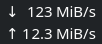
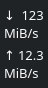
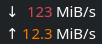
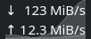
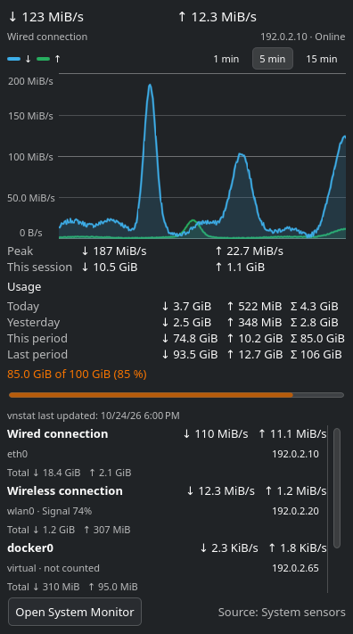

<!--
SPDX-License-Identifier: GPL-2.0-or-later
SPDX-FileCopyrightText: 2026 Flexomatic81
-->

# Netspeeder

A network speed monitor for the KDE Plasma 6 panel. Netspeeder shows the
current download and upload speed: it counts the traffic of your real network
devices once, without double-counting VPN and container interfaces, and it
keeps the panel stable instead of jumping around. A click opens a popup with a
traffic graph, peaks, totals and the interface list; with vnStat installed it
also shows your daily and monthly data usage and can warn you before a data
cap is reached.

It is written in plain QML and JavaScript (no C++), so it installs like any
other widget and needs no extra packages on a standard Plasma installation.

Netspeeder is the successor of the
[Netspeed Widget](https://github.com/dfaust/plasma-applet-netspeed-widget) by
Daniel Faust, see [Origin](#origin). If you used that widget, read
[Coming from Netspeed Widget](#coming-from-netspeed-widget).

## Screenshots

The images are made from fixed demo data with `scripts/screenshots.sh` and
live in [`docs/images/`](docs/images/).

| | |
|---|---|
|  | `panel-rows.png`: two rows in a horizontal panel |
|  | `panel-single.png`: both values side by side in one row |
|  | `panel-vertical.png`: a vertical panel |
|  | `panel-colors.png`: colors by speed |
|  | `panel-sparkline.png`: the sparkline behind the values |
|  | `popup.png`: the popup with graph, interfaces and usage |

## Features

- **Panel view** with download and upload speed, as two rows or side by side.
  In automatic mode a horizontal panel uses two rows as long as each row can
  hold readable text, a vertical panel always stacks. Optional: upload first,
  one combined value.
- **No jumping:** digits have a fixed width and the panel reserves the width of
  the widest possible value.
- **Units:** bytes with binary prefixes (KiB/s), bytes with decimal prefixes
  (kB/s) or bits (Mbit/s); short unit names; decimal places; values below a
  threshold show as 0; update interval from 0.5 to 10 seconds. The decimal
  separator follows your locale.
- **Correct totals:** by default the sum covers the physical network devices
  only. VPN tunnels, Docker bridges and other virtual interfaces are not
  counted twice. You can also pick the interfaces by hand.
- **Robust against change:** an interface that disappears and comes back (VPN
  reconnect, Wi-Fi, USB tethering) starts again at 0 instead of a spike, and
  jumps caused by counter resets are discarded. When the data stops coming,
  the widget marks it as stale instead of showing frozen speeds.
- **Tooltip** with the connection name, download, upload and IP address, the
  traffic of the day (with vnStat), and a note when the data source has a
  problem.
- **Popup and desktop view** with a traffic graph, peaks, session totals and
  the interface list.
- **Appearance:** font, bold, text size, symbols, colors by direction or by
  speed, a sparkline.
- **Behavior:** configurable left and middle click, a launch target, and
  automatic hiding when offline or idle.
- **Data usage** per day and billing period from vnStat (optional), with a data
  cap, a warning level and notifications.
- **Settings** pages "Display", "Appearance", "Data", "Usage" and "Behavior".
  The data page lists every network interface with its kind and current speed.
- **Translations:** English and German.

### Popup and desktop view

A click on the panel view opens a popup (the left click by default). The same
view can also sit directly on the desktop (Plasma's "Add Widgets" on the
desktop); there it is always shown and has no popup. It contains:

- **Header** with the live download and upload speed, the connection state
  (online, offline, no data yet, no current data) and a hint when the data
  source has a problem.
- **Traffic graph** with a time window of 1, 5 or 15 minutes. The selected
  window is kept in the configuration and survives a restart. The graph needs
  Qt Quick Charts; it is loaded in isolation, so without it only the graph is
  replaced by a note and the rest of the popup works. The x axis is per
  sample, not a wall-clock scale.
- **Peaks and session totals** for download and upload.
- **Interface list**, scrollable, with markers for virtual and uncounted
  interfaces and the Wi-Fi signal, totals per interface and the IPv4 address,
  which you can copy with one click.
- **Usage** from vnStat, see [Data usage and data cap](#data-usage-and-data-cap).
- **Footer** with an "Open System Monitor" button and the active data source.

The popup follows the data only while it is visible, so a closed popup costs
nothing.

### Appearance

The settings page "Appearance" controls how the panel view looks:

- **Font:** the theme font by default, or any installed font; optional bold;
  text size from 50 to 200 %. Above 100 % the size is capped so that the text
  line still fits its row.
- **Symbols:** arrows (default), triangles, icons, none, or custom text for
  the download and the upload symbol.
- **Colors:** the theme color (default), a fixed color per direction, or
  colors by speed. By speed uses up to six levels, each with a minimum speed
  and a color; the editor keeps the minimums distinct, invalid stored levels
  are dropped, and the defaults (0, 1, 10 and 100 MiB/s) apply only when no
  level is usable. A level without a color uses the theme color. Optionally
  the units and symbols take the color too.
- **Fixed width:** on by default; the panel keeps the width of the widest
  value, also with bold or another font.
- **Sparkline:** a small traffic graph, off by default, drawn behind the
  values or beside them. In a vertical panel "beside" behaves like "behind".
  Its scale starts at 0 and covers at least 1 KiB/s.

### Auto-hide

The settings page "Behavior" has an auto-hide setting: never (default), when
offline, or when offline or idle. The connection counts as idle when the
traffic stays below a threshold (default 1 KiB/s, 1 to 1024 KiB/s) for a
duration (default 30 seconds, 5 to 3600). A hidden widget is collapsed by the
panel; in edit mode it shows as a dimmed network icon so that it can still be
found. It never hides on the desktop, while the popup is open, before the
first data has arrived, or while the data is stale (a frozen source keeps
showing its dimmed values).

### Click behavior and launch target

The settings page "Behavior" sets what the left and the middle click do:
open the popup, start the launch target, or nothing (middle click default:
nothing). The page warns when neither click opens the popup; the popup is then
only reachable on the desktop.

The launch target is either an **application** (pick a `.desktop` file in the
file dialog; the desktop ID is stored, default System Monitor) or a **command**.
The target is checked before it starts: an unknown application or a command
that cannot be found gives a desktop notification instead of failing silently.

Limitations:

- A command is pre-checked only when its first word is a plain name or a path;
  for anything else (shell syntax, variables) it is started unchecked.
- A launch that fails after it started (the program crashes) is not detected.

### Data usage and data cap

Netspeeder can show how much you have transferred per day and per billing
period. The numbers come from [vnStat](https://humdi.net/vnstat/), which keeps
its own statistics in the background, so they cover the time before the widget
started and survive a restart. vnStat is optional: without it everything else
works and the popup shows a hint instead.

The popup gets a "Usage" section with download, upload and total for

- **Today** and **Yesterday**,
- **This period** and **Last period**. A billing period starts on a day of the
  month you choose (1 to 28, default 1).

A period that vnStat does not cover completely (for example right after
vnStat was installed) is marked with an asterisk and a footnote. Below the
figures the popup says when vnStat last updated its data, with a hint when
that is more than an hour ago (the vnStat service is probably not running).
It also tells you when vnStat is missing (with a link to its website), when
its version is not supported, and when an interface that counts is not tracked
by vnStat.

**Data cap:** optionally set a monthly cap in GiB and a warning level in
percent (default 80). The popup shows the share of the cap as a bar. From the
warning level the bar takes the neutral color of the theme, from 100 % the
negative color. In the panel a small dot appears from the warning level on;
its accessible name mentions the cap for screen readers. The tooltip gets a
"Today" line with the traffic of the day.

**Notifications:** when the warning level and when 100 % are reached, one
desktop notification each per billing period. What has been reported is stored
in the configuration, so a restart of Plasma does not repeat it. If the usage
jumps straight past 100 %, only the 100 % level is reported. With
notifications switched off the level is still recorded, so switching them on
later does not report levels that were reached earlier.

The settings page "Usage" has these options: show usage from vnstat (on by
default; it also shows whether vnstat can be read), the data cap (off by
default), the monthly cap, the day the billing period starts, the warning level
and the notification switch.

**Which interfaces count:** in manual mode the interfaces you selected on the
page "Data" count, even while they are absent (a USB tethering device that is
unplugged keeps its past traffic in the sum). In automatic mode the interfaces
vnStat knows count, except `lo`, the interfaces the widget currently sees as
virtual and those it has seen as virtual before. The widget remembers every
virtual interface it sees, so a VPN tunnel stays out of the totals after a
disconnect; names that vnStat no longer knows are forgotten again. A virtual
interface that vnStat recorded but the widget has never seen (for example one
from before the widget was installed) still counts until it appears once,
until you switch to manual selection, or until you remove it from vnStat. The
data cap is checked only once the widget knows its interfaces, so a reading
right after login cannot count a tunnel and report a level too early.

The tooltip leaves out the "Today" line while vnStat tracks none of the
interfaces that count.

## Coming from Netspeed Widget

Netspeeder has its own widget ID (`io.github.flexomatic81.netspeeder`), so
Plasma treats it as a different widget:

- **Your settings are not taken over.** Add Netspeeder to the panel and set it
  up once with the table below.
- **Both widgets can run side by side.** Keep the Netspeed Widget until
  Netspeeder is set up, then remove the old one from the panel.

The table lists every setting of the Netspeed Widget by its configuration key
and where to find it in Netspeeder (settings page › option).

| Netspeed Widget key | Netspeeder |
|---|---|
| `showSeparately` | Display › "Show only the combined speed" (the sum of download and upload). Turn it on where `showSeparately` was off. |
| `showLowSpeeds` | Display › "Show as 0 below:". On maps to "Off" (every speed is shown); off, the old default, maps to "1 KiB/s", which is also the default here. In bits mode the old cut-off was about 125 B/s; the nearest choice is "512 B/s". |
| `speedLayout` | Display › "Layout:" Automatic, Two rows or Side by side. |
| `swapDownUp` | Display › "Order:" Upload first. |
| `showIcons` | Appearance › "Symbols:" on maps to Arrows, off maps to None. Triangles, Icons and Custom are new. |
| `showUnits` | Not available: Netspeeder always shows the unit. Display › "Use short unit names" keeps it narrow. |
| `speedUnits` | Display › "Units:" Bytes, binary (KiB/s); Bytes, decimal (kB/s); or Bits (Mbit/s). |
| `shortUnits` | Display › "Use short unit names". |
| `fontSize` | Appearance › "Text size:" 50 to 200 %. The old range started at 10 %; sizes below 50 % have no equivalent. "Font:" and "Bold" are new. |
| `updateInterval` | Display › "Update interval:" 0.5 to 10 seconds. |
| `customColors` | Appearance › "Colors:" By speed. "By direction" (one color for download, one for upload) is new. |
| `byteColor`, `kilobyteColor`, `megabyteColor`, `gigabyteColor` | Replaced by Appearance › "Speed levels:" up to six levels, each with a minimum speed and a color. With byte units, levels at 0 B/s, 1 KiB/s, 1 MiB/s and 1 GiB/s come close to the old colors per unit. With bits, the old switch points were 1 kbit/s, 1 Mbit/s and 1 Gbit/s, that is levels at 0, 125, 125000 and 125000000 B/s. The old widget colored only the number, so leave "Color units and symbols too" off (the default). |
| `launchApplicationEnabled` | Behavior › "Left click:" Start the application or command. The middle click can do the same. |
| `launchApplication` | Behavior › "Start:" Application, then "Application:" (the desktop ID, or "Choose…" to pick it). "Command" is new. |
| `interfacesWhitelistEnabled` | Data › "Interfaces counted in the total:" Selected interfaces only. Often not needed any more: the automatic mode already leaves out VPN and container interfaces. |
| `interfacesWhitelist` | Data › the interface list below that option; check the interfaces to count. |

## Requirements

- KDE Plasma 6.3 or newer, with KDE Frameworks 6.10 and Qt 6.8 or newer (see
  [docs/compatibility.md](docs/compatibility.md)). The widget declares API 6.0
  in its metadata; that value names the applet API generation, not the
  minimum.
- Nothing else for the default data source: it uses the system sensors
  (`ksystemstats`) that every Plasma installation ships.
- Optional: vnStat 2.0 or newer for the usage statistics and the data cap, see
  [Installing vnStat](#installing-vnstat-optional).

## Installation

### KDE Store

Right-click the panel or the desktop, choose "Add Widgets…", then
"Get New Widgets…" › "Download New Plasma Widgets", and search for
"Netspeeder".

### Package file (`.plasmoid`)

Download `netspeeder-1.0.0.plasmoid` from the releases page of the project.
In "Add Widgets…" choose "Get New Widgets…" › "Install Widget From Local
File…" and pick the file, or install it in a terminal:

```sh
kpackagetool6 -t Plasma/Applet -i netspeeder-1.0.0.plasmoid
# update an existing installation:
kpackagetool6 -t Plasma/Applet -u netspeeder-1.0.0.plasmoid
```

If the widget does not show up in the list, restart the panel:
`systemctl --user restart plasma-plasmashell`.

You can build the file yourself: `scripts/build-plasmoid.sh 1.0.0` writes
`dist/netspeeder-1.0.0.plasmoid` (needs `gettext` and `libarchive`).

### Arch Linux (AUR)

The package `plasma6-applets-netspeeder` is planned but does not exist yet.
Once it is published, install it with your AUR helper, for example:

```sh
yay -S plasma6-applets-netspeeder
```

### From source

For a user installation:

```sh
git clone https://github.com/Flexomatic81/netspeeder.git
cd netspeeder
scripts/dev-install.sh
```

The script compiles the translations and installs the widget into
`~/.local/share/plasma/plasmoids`. A running panel keeps the old version until
plasmashell restarts. `scripts/run.sh` opens the installed widget in its own
window instead.

For a system-wide installation (and distribution packages) use CMake. It needs
CMake, `extra-cmake-modules`, the Plasma and KDE Frameworks 6 development
files (`libplasma`, `ki18n`) and `gettext`.

```sh
cmake -S . -B build -DCMAKE_INSTALL_PREFIX=/usr
cmake --build build
sudo cmake --install build
# for a package: DESTDIR="$pkgdir" cmake --install build
```

This installs the widget to `<prefix>/share/plasma/plasmoids/` and the
translations to `<prefix>/share/locale/`.

### Installing vnStat (optional)

Only the usage statistics and the data cap need vnStat, version 2.0 or newer
(it writes JSON version 2). Install the `vnstat` package with your
distribution's package manager, then enable the service so that it collects
data:

```sh
systemctl enable --now vnstat
```

It takes a day for the first daily figures to appear.

## Data sources and interface detection

Netspeeder reads the network counters in one of two ways. The default is
automatic:

1. **System sensors (`ksystemstats`)**, the default. The values come straight
   from the system monitor backend of Plasma. No process is started at an
   update. This source lists the devices that NetworkManager manages.
2. **Kernel counters (`/proc/net/dev`)**, the fallback. It sees every
   interface, including VPN tunnels and containers, but it starts a small
   process at every update.

In automatic mode Netspeeder switches to the kernel counters when the sensor
module does not load or when the system sensors report no network interface
for ten seconds. The tooltip and the data page tell you when this happened.
You can also fix the source in the settings.

**Which interfaces count:** a device is *physical* when
`/sys/class/net/<name>/device` exists. Everything else (loopback, Docker
bridges, `veth` pairs, tunnels, WireGuard, tun/tap) is *virtual*. In automatic
mode the total is the sum over the physical devices. In manual mode it is the
sum over the interfaces you selected, whatever their kind. The loopback
interface is never counted. If a device is misclassified, for example a modem
without a `device` entry, pick the interfaces by hand.

## Translating

All visible texts go through KDE's `i18n` functions, translation domain
`plasma_applet_io.github.flexomatic81.netspeeder`. The message template is
`po/plasma_applet_io.github.flexomatic81.netspeeder.pot`, the translations
live in `po/<language>/plasma_applet_io.github.flexomatic81.netspeeder.po`.

```sh
scripts/Messages.sh      # extract the texts, merge into all translations
```

To add a language, create the file from the template, translate it and open a
pull request:

```sh
mkdir po/fr
msginit --no-translator --locale=fr --input=po/plasma_applet_io.github.flexomatic81.netspeeder.pot \
  --output=po/fr/plasma_applet_io.github.flexomatic81.netspeeder.po
```

`scripts/build-mo.sh` compiles the translations into the package
(`scripts/dev-install.sh` and `scripts/build-plasmoid.sh` call it for you).

## Development

`node tools/check.mjs` is the one entry point; CI runs the same steps.

| Command | Purpose |
|---|---|
| `node tools/check.mjs` | All steps: `eslint`, `format`, `test`, `qmllint`, `shellcheck`, `actionlint`, `smoke`, `load` |
| `node tools/check.mjs fast` | Group `fast`: the Node checks (`eslint`, `format`, `test` with its coverage floor); a few seconds |
| `node tools/check.mjs <step>...` | Only the named steps, e.g. `qmllint` or `shellcheck qmllint` |
| `node tools/check.mjs --install-hook` | Installs a pre-commit hook that runs the `fast` group |
| `pnpm test` | Only the unit tests of the logic modules (`package/contents/code/*.mjs`) |
| `scripts/smoke.sh` | QML smoke scenes with `qml6`; local only, needs `ksystemstats`, a connected network interface and a desktop session (`NETSPEEDER_SMOKE_SKIP_LIVE=1` skips the scenes that read the real network) |
| `scripts/load-check.sh` | Starts the installed widget offscreen and checks that it loads; needs a desktop session |
| `scripts/build-plasmoid.sh <version>` | Builds `dist/netspeeder-<version>.plasmoid` |
| `scripts/screenshots.sh` | Renders the screenshots in `docs/images/` from demo data; opens windows on the desktop |

Run `pnpm install --frozen-lockfile` once for the Node tools. `qmllint` needs
the Qt 6 tool (`/usr/lib/qt6/bin/qmllint`); locally, steps that need Qt or a
desktop session are reported as skipped. In CI a missing `qmllint` fails the
run, and `smoke` and `load` are skipped. See
[CONTRIBUTING.md](CONTRIBUTING.md) for the workflow.

Continuous integration (`.github/workflows/ci.yml`) runs the `fast` group on
Node 22.13 and 24, shellcheck, actionlint and `qmllint`, and builds the `.plasmoid` for
version tags. [docs/testing.md](docs/testing.md) is the manual checklist that
is worked through before each release, and
[docs/compatibility.md](docs/compatibility.md) lists what the oldest supported
Plasma must provide.

## Origin

Netspeeder is based on the
[Netspeed Widget](https://github.com/dfaust/plasma-applet-netspeed-widget) by
Daniel Faust (GPL-2.0-or-later). It is a new code base, not a GitHub fork, but
it keeps ideas of the original and the copyright notices of the files that
carry them. It also addresses a number of the problems reported in the issue
tracker of the original; see [CHANGELOG.md](CHANGELOG.md).

## License

GPL-2.0-or-later. See [LICENSE](LICENSE).

Copyright 2026 Flexomatic81. Parts based on the Netspeed Widget, copyright
2016 Daniel Faust.
